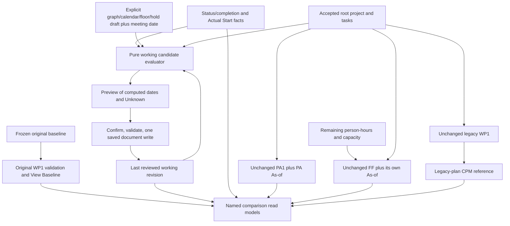

# P12 - Sources of truth and evaluator/edit boundaries

**Established intent:** distinct baseline, reviewed working promise and actual
evidence; unchanged first-slice PA1/FF/legacy CPM. **Deferred mechanism:** P12.
Recommend the boundaries below, not automatic rewiring of current consumers.
See [WP7.4 audit](../wp7-4/ARCHITECTURE-AUDIT.md) and
[current App orchestration](../../../src/App.tsx#L90).

## Authoritative versus calculated views

| Name | Exact inputs | Authority / permitted use |
| --- | --- | --- |
| Frozen baseline B | Original baseline inputs/calendar, original stored WP1 schedule and interpretation | Original accepted reference forever; View Baseline/comparisons. Never replaced by W, PA or new evaluator. |
| Legacy current plan C | Current root project/tasks through unchanged calculateSchedule | Current WP1 source interpretation. After v6 activation this is an explicitly named legacy-plan reference, not the revised working promise. |
| Reviewed working commitment W | Last confirmed workingPlan constraints/commitments and revision | Authoritative planned promise after explicit review. Stored start/finish is distinct from notBefore and live feasibility. Local today or render never rewrites it. |
| Actual evidence A | Existing status/completion history plus append-only Actual Start | Authoritative local attestations, date-only and qualified for future/conflicting/missing evidence. Neither logs nor planned slots fill gaps. |
| Working candidate W* | Validated explicit candidate graph/calendar/floors/holds, W, A, review date and affected set | Pure proposal; Known/Unknown and all binding causes. Becomes W only through confirmed, saved transaction. No direct component publication. |
| PA1 | Current root project/tasks, existing progress, explicit PA As-of through unchanged calculateProgressImpact | Conditional outlook using C floor, not revised W floors. Label **PA1 / legacy-plan reference** when W differs. Do not pretend unchanged PA1 includes new constraints/Actual Start. |
| FF | Current root source tasks/project/manual order, remaining person-hours, existing progress, optional baseline/settings and explicit today/FF As-of | Shared-capacity person-hour forecast. Keep formulas/priority rules; changed source graph can change results. No W/Actual Start/readiness injection. Label its C commitment comparison explicitly when W differs. |
| Legacy CPM | Root project/tasks and their exact C result through unchanged analyzeCriticalPath | Criticality/slack of legacy WP1 plan only. Never label W*/actual paths critical or feed hybrid date-only nodes to positive-duration CPM. |

Status remains one of four deliberate values. Actual Start can be Unknown for
In Progress, and does not supply a finish/duration or decrement effort. Reopened
first start is history, not a restart. If the owner later wants W-aware PA,
FF commitment priority or working-plan CPM, that is a separately authorized
algorithm/reference change. No ambiguous generic "current finish" API.

Alternatives are to extend legacy WP1 in place or make PA/FF/CPM all consume
W immediately. Neither is recommended for the first slice: the former risks
baseline reinterpretation, the latter bundles new algorithms with evidence
capture. Keep separate named adapters and approve integration independently.



## Proposed pure interface, not implementation

```ts
type Issue = { code: string; taskId?: TaskId; relatedIds?: readonly TaskId[];
               message: string }
type Bound = {
  kind: 'Project' | 'Floor' | 'Hold' | 'ReviewDate' | 'Predecessor';
  slot: WorkingSlot; predecessorId?: TaskId; eventId?: Id;
  precision: 'PlannedSlot' | 'ConservativeActualDate';
}
declare function evaluateWorkingCandidate(input: {
  project: Readonly<ProjectSettings>;
  tasks: readonly TaskInput[];          // candidate retained graph, full slots
  progress: Readonly<ProgressTracking>; // existing decoded four-state evidence
  actualStarts: ReadonlyMap<TaskId,
    { kind: 'Known'; date: DateOnly; eventId: Id } | { kind: 'Unknown' }>;
  current: Readonly<WorkingState>;
  proposedFloors: ReadonlyMap<TaskId, WorkingSlot>;
  holds: ReadonlyMap<TaskId, WorkingSlot | null>; // explicit keep or omit
  affectedIds: readonly TaskId[];
  reviewDate: DateOnly;
}):
  | { ok: false; issues: readonly Issue[] }
  | { ok: true; ruleVersion: 1; topologicalIds: readonly TaskId[];
      candidates: readonly (
        { kind: 'Known'; taskId: TaskId; notBefore: WorkingSlot;
          start: WorkingSlot; finish: FinishBoundary; binding: readonly Bound[] } |
        { kind: 'Unknown'; taskId: TaskId; reasons: readonly string[];
          lowerBounds: readonly Bound[] } |
        { kind: 'ActualOnly'; taskId: TaskId; actualDate: DateOnly;
          release: WorkingSlot | null } |
        { kind: 'Retained'; taskId: TaskId;
          currentCommitment: WorkingState['commitments'][string];
          feasibilityIssues: readonly string[] }
      )[];
      requiredReviewIds: readonly TaskId[];
      conflicts: readonly string[];
      project: { kind: 'Actual' | 'Conditional' | 'Unknown';
                 date: DateOnly | null; finish: FinishBoundary | null;
                 uncertain: boolean } }
```

`Bound` carries kind (Project/Floor/Hold/ReviewDate/Predecessor), planned slot,
optional predecessor/event ID and date-only precision explanation. ActualOnly
never contains an invented actual finish boundary. No Date.now, storage, React,
mutation, work logs, remaining person-hours, team capacity or baseline writes.
The first slice can use hand-supplied actual-start read facts; it does not
implement their history decoder or capture UI. Validate IDs/dates/slots before
evaluation, use existing graph/calendar utilities, canonical ID order and
exact planned boundaries. Same inputs yield same result, independent of task
array/display order. Do not enumerate all dependency paths.

Proposed floors cover all candidate task IDs; actual-start map omissions mean
Unknown, and extra unknown references reject. Every affected task has an
explicit hold entry: its exact old Known start for Keep, or null for a deliberate
replacement/new task. Validate old boundaries against the old working calendar,
not a newly edited calendar/duration; the codec validates their historical
Core. Future facts are qualified relative to reviewDate. An all-complete
supported project is Actual with date-only finish and null slot boundary;
remaining supported work is Conditional, missing/conflicted evidence Unknown.
Reject new/changed normalized floors before reviewDate or project start;
unchanged historical floors may remain lower bounds. The later UI/coordinator
also validates the requested raw date before normalization and confirms the
computed result, rather than disguising a past date through calendar roll-forward.

Every retained predecessor participates, including one outside the affected
closure. A future unstarted unaffected commitment can provide a planned bound
only if its retained constraints support it. A past unfinished promise or a
bound that would itself need revision requires prerequisite review, exposed
in requiredReviewIds; otherwise successor remains Unknown/Unresolved. Do not
pretend an overdue Not Started predecessor already finished, or silently
reschedule unrelated promises. This readiness mechanism is a new P12 choice
requiring approval. Evaluate prerequisite checks topologically; add each
required review once. Completed/started facts are never moved to fit the graph.

## Exact pre-review completion reference

Capture context **before** appending completion, changing floor/graph/calendar
or computing W*. Lookup by permanent task ID in the accepted W revision:

1. If a Known reviewed planned commitment exists, save its finish **date** and
   revision as Reviewed; preserve planned-hour precision only in its separate
   revision, not as an actual finish hour. The old promise can be known even
   when live started-task feasibility is Unknown; those are different fields.
2. If only ReferenceOnly/absent/unknown commitment exists, save Unknown and no
   manufactured committedFinishDateAtCompletion. Do not substitute baseline,
   C, PA1, FF or the just-calculated candidate.
3. During an explicit legacy copy-upgrade, Seed first establishes the accepted
   legacy planned promise after preview. A completion in the same final write
   can reference that Seed revision, whose initialCore is **before** completion.
   Seed+Review may be two consecutive document revisions in the one key write.
4. Already imported completion events never change. Their existing saved
   finish field becomes LegacySnapshot context; missing field stays Unknown.
   No retroactive W revision is invented. New corrections append evidence;
   old historical comparisons/criteria remain intact.

Worked controls: W before A finishesNov2, actualNov6, candidate projectNov10:
new completion compares6 with2, **+4 calendar days**, never10. W finishNov13,
actualNov11 means2 days early; B defaults keep16 and can expressly advance12
only after all releases. BaselineNov2/CNov3 plus missing W reference means
historical comparison Unknown, not one/four invented days. Actual6 still
provides conservative future release9 if active/non-future; historical lateness
need not be known to establish that bound. Joins retain all ties; a required
started/blocked/reopened predecessor stays Unknown despite a person-hour estimate.

## Every editing path must honor the same gate

| Existing entry point | Future v6 boundary required |
| --- | --- |
| TaskEditor Save / inline name, duration, manual start, dependencies | Stage source edit. Project/task changes require validated candidate state and explicit before/after working revision; cosmetic-only changes can show zero date impact, but cannot bypass source revision/hash checks. |
| DependencyPicker Done / outside commit | Commit only to the local draft. It must not call accepted-source mutation directly in v6. Final graph validation handles retained manual reactivation and all joins. |
| Project/calendar/date/settings edits | Stage calendar/task interpretation and planned-boundary normalization; show computed commitments and baseline comparison. Never normalize historical actual dates/baseline with the new calendar. |
| Complete / reopen / status / Actual Start correction | Coordinate one whole candidate, existing criteria/reopen effort validation, pre-review reference and appended evidence. A direct applyStatus call is not the new transaction. |
| Duplicate / delete | Fresh identity/explicit new promise or P11 refusal; affected successor preview before acceptance. No copy of history/floor or accepted deletion during a review. |
| Load/import/new / replacement | Dirty-review discard confirmation, codec/baseline identity checks and atomic replacement. Existing old-format reading remains; incomplete public v6 support stays disabled. |
| Header Save / Save As / JSON export | Save accepted or explicitly confirmed candidate only; never serialize half a review. Lock/source check and one write. Export includes exact accepted evidence, no lossy version downgrade. |

On opening review record complete document fingerprint/revision plus local
meeting date. Block concurrent local mutation; other-tab storage notification
invalidates the preview and requires reload/rebase, not automatic acceptance.
Back-navigation edits invalidate dependent decisions. Date rollover refreshes
new planned-date validity, not PA/FF settings or accepted promises.

No public v6 activation is safe until **all** these paths and reference labels
are integrated. Existing v1-5 app remains untouched in the first unwired slice.
Risk: adding a new evaluator behind only the wizard while inline edits or Save
still bypass it would produce two incompatible working plans. Approval must
name these boundaries before integration, not infer them from a successful
pure calculation or storage spike.
