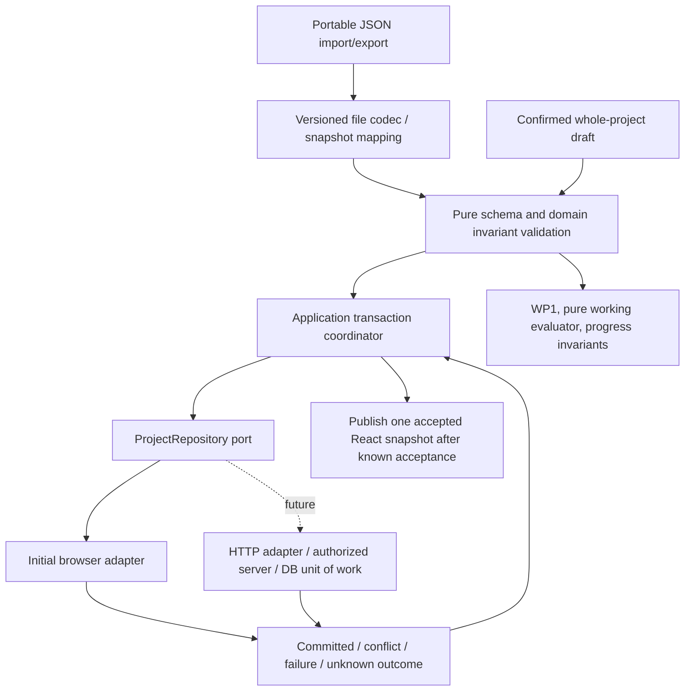

# Proposed storage-independent project repository port

Established: whole-project conditional save, no lost accepted revision,
atomic reviewed changes, immutable first baseline and storage-independent domain.
Pending: the following exact port, identity/revision and failure mechanisms.
This is a design example, not a new production module.

## Identity and one authoritative revision

`RepositoryProjectId` identifies one stored working copy in one repository
namespace. Stable opaque IDs survive renames/edits and are never a display name,
browser key or task ID. The existing `project.projectId` remains the portable
**lineage ID**; it and the baseline's original project ID are preserved. Two
Save As copies have different repository IDs but the same unchanged lineage,
task IDs, baseline and prior history. Copies are not edits to the source.

`snapshot.logicalRevision` is the sole current project revision number: a safe
positive integer, incremented once per new accepted domain change. A grouped
revision can contain completion, criteria attestation, dependency decisions,
commitments/corrections and Unresolved evidence. The port's RevisionRef reads
that number and its canonical semantic fingerprint; no independently incremented
entryRevision, clock timestamp or physical row version is a second authority.
Historical group revision numbers are validated stamps, not competing counters.

Create/import may store an already-valid revision17 as the first local copy;
it preserves17. Its first new domain commit is18. A legacy copy-upgrade creates
logical1, with Seed and optional Review operations together, not revisions1/2
for one acceptance. Export/copy/rename of a repository label is not a domain
event. Repository metadata changes need their own future scope if exposed.

## Example TypeScript contract

`ProjectState` contains current domain inputs, immutable original baseline,
status/actual evidence and reviewed working commitments, independent of files.
Its model validation is a separate pure contract; these types do not implement it.

```ts
type RepositoryProjectId = string // opaque within repository namespace
type TransactionId = string
type Fingerprint = string       // profile snapshot-c14n/1, SHA-256
type RevisionRef = Readonly<{ revision: number; fingerprint: Fingerprint }>
type ProjectSnapshot = Readonly<{
  modelVersion: 1;
  logicalRevision: number;
  state: ProjectState;
  history: readonly AcceptedRevisionGroup[];
}>
type AcceptedRevisionGroup = Readonly<{
  revision: number;
  transactionId: TransactionId;
  previousFingerprint: Fingerprint | null;
  operations: readonly DomainOperation[];
}>
type LoadedProject = Readonly<{
  projectId: RepositoryProjectId;
  label: string;
  ref: RevisionRef;
  snapshot: ProjectSnapshot;
}>
type Receipt = Readonly<{
  projectId: RepositoryProjectId;
  transactionId: TransactionId;
  committedRef: RevisionRef;
}>
type Failure =
  | { kind: 'NotFound'; projectId: RepositoryProjectId }
  | { kind: 'Conflict'; code: 'StaleRevision' | 'TransactionIdReuse';
      currentRef?: RevisionRef }
  | { kind: 'Unsupported'; code: string; message: string }
  | { kind: 'Validation'; issues: readonly DomainIssue[] }
  | { kind: 'StorageFailure'; code: string; retryable: boolean;
      outcome: 'NotCommitted'; message: string }
  | { kind: 'AccessDenied'; message: string }; // reserved for future server policy
type OutcomeUnknown = {
  kind: 'OutcomeUnknown'; transactionId: TransactionId;
  message: string; // may have committed; retain request and reconcile
}
type WriteResult =
  | { kind: 'Committed'; receipt: Receipt; currentRef: RevisionRef }
  | { kind: 'AlreadyCommitted'; receipt: Receipt; currentRef: RevisionRef }
  | Failure | OutcomeUnknown;
interface ProjectRepository {
  load(id: RepositoryProjectId): Promise<
    { kind: 'Loaded'; project: LoadedProject } | Failure>;
  list(query: { cursor?: string; limit: number }): Promise<
    { kind: 'Listed'; items: readonly ProjectSummary[]; nextCursor?: string } |
    Failure>;
  create(request: {
    transactionId: TransactionId; label: string; snapshot: ProjectSnapshot;
  }): Promise<WriteResult>;
  commit(request: {
    projectId: RepositoryProjectId; expected: RevisionRef;
    transactionId: TransactionId; candidate: ProjectSnapshot;
  }): Promise<WriteResult>;
}
```

Create returns a newly assigned repository ID in its receipt. A matching create
retry returns AlreadyCommitted for that same ID. Names are proposed nonempty
display labels (shared profile1-120 characters), **not unique identity**; same
label/different create IDs produce separate copies. Labels never rewrite the
domain project name. ProjectSummary is ID/label/ref, not a partial editable
project. List limit1-100; cursor is opaque and scoped to the repository, not
portable history. Listing is discovery, not an atomic multi-project snapshot;
subsequent load can fail/change. Identity/naming choice is an owner gate.

The receipt names the **committed** revision; currentRef can be newer on an
idempotent retry. The coordinator cannot publish an old receipt's candidate
over later accepted state. If refs differ, load/reconcile the current snapshot.
No auto-merge or task-level concurrency is promised. Different-task edits from
the same expected project revision may legitimately conflict.

## Commit semantics and idempotency

1. Freeze the complete candidate and immutable request outside the repository;
   validate shapes/domain invariants and confirmed preview. Candidate revision
   must equal expected.revision+1, without overflow. Its final group transaction
   ID matches the request; prior groups/events/baseline remain unchanged.
2. At the adapter's atomic boundary, check access policy where applicable,
   locate resource, check a durable receipt, compare expected revision **and**
   fingerprint, validate against accepted state/known baseline, and accept or reject.
3. A matching receipt/digest returns the original committedRef before a stale
   retry is rejected. Same scoped transaction ID with different intent returns
   Conflict(TransactionIdReuse). Receipts survive at least the resource lifetime;
   no silent expiry may turn an old retry into a duplicate commit.
4. A new successful request replaces the full accepted snapshot and records
   its receipt in the same atomic unit. No partial graph/event/promise writes.
   All definitive failures leave prior accepted project data unchanged.

Commit receipt scope is `(repository namespace, projectId, transactionId)`;
create scope is `(repository namespace, transactionId, Create)`. The digest
binds operation, target if present, expected ref if present, label for create,
model version and complete candidate semantic fingerprint. No self-hashing
receipt is inserted into the domain snapshot. Changing destination/resource
or candidate is a new intent; do not reuse an old ID.

Receipts/routing/auth metadata are not portable history. Importing into another
repository creates a new resource and new create receipt while retaining domain
history/revisions. Old pending commands stay bound to their original repository
handle/ID; they are not silently retargeted. Duplicate historical domain-group
IDs still reject as append-only validation, even without old transport receipts.

## Layer responsibilities and publication



File codec owns portable version/JSON/size handling; the snapshot mapper owns
format6-to-model conversion. Pure invariant validation owns task/event graph,
append-only corrections, original baseline equality/interpretation and reviewed
commitment consistency. Repository boundary repeats authoritative validation;
a client TypeScript brand/checksum is not proof. Browser encoding and future
HTTP/DB mapping live in adapters. Orchestration owns review date, transaction
IDs, confirmation, retries and accepted-state publication. Domain scheduling/
progress never imports Storage, navigator, fetch, SQL or React.

After definitive write success, publish exactly one accepted snapshot and saved
ref. A rendering failure after persistence is not a storage rollback. Cancellation
before dispatch leaves accepted data unchanged. **After dispatch, timeout/abort
can mean OutcomeUnknown**, not a proven failure/cancellation; retain request
and resolve by same-ID retry/load. This required qualification conflicts with
any unqualified post-dispatch no-write promise and needs owner confirmation.
No new cancellation/locking UI is implemented here.

Atomicity is for one project's accepted revision and its receipt. Browser
layout may physically replace a whole library, while a DB transaction may
write normalized entities. Neither implies atomic multi-project edits,
distributed transactions, real-time sync or physical power-loss durability.
