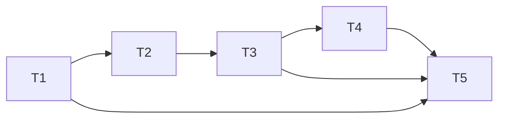

# Complete fictional JSON examples

Each linked file is a **complete proposed format6 document**, including full
current state, original-baseline representation, history and a concrete digest.
There are no elided fields, partial patches or production files. Pretty layout
is for review; canonical export bytes are defined separately. Do not import
these into today's app: its unchanged reader supports formats1–5 only.
WP7.4.4a re-authors these unreleased examples as `snapshot-history/2`, adding
explicit lifecycle/archives/reviews. Original77 checks/inventory refer to the
pre-amendment `/1` files at fd7fee9; current checks are linked from
[AMENDMENT-SUMMARY](AMENDMENT-SUMMARY.md). No production converter is delivered.

All scenarios use2026 dates. The late case uses Monday–Friday, four planned
working slots/day. Slot numbers are not clock hours. The review date is an
explicit fictional November9, not the execution machine's today. A date-only
November6 completion is treated conservatively as end-of-day for dependency
release: next working slot is Monday November9/hour1. This is the existing
working-evaluator rule, not a forecasting/effort formula change.

## T1 late, T2 has not actually started

Read [late-retained.json](examples/late-retained.json).

| Meaning | T1 | T2 |
| --- | --- | --- |
| Original immutable baseline | November2/hour1 → after hour2 | November2/hour3 → after hour4, predecessorT1 |
| Stored reviewed current promise | Retained original November2 finish | Explicitly revised to November9/hour1 → after hour2 |
| Recorded actual | Complete on November6; Actual Start Unknown | Not Started, Actual Start and completion Unknown |
| Effort | Two planned slots;2 recorded person-hours; stored remaining2 retained, effective future work0 | Two stored remaining person-hours; no actual date inferred |

The completion claim keeps `committedAtCompletion` pointing to W-original/
November2. It does not substitute the revised downstream schedule or today's
baseline. Empty criteria have explicit acknowledgement. Optional work logs
do not prove total actual effort, and none of these fields implies T1 was
actually done on November2 or that T2 started on its old planned date.

## Historical T2 Actual Start: retain versus sever

The following are independent revision3 branches from the same revision2
snapshot. Their equal counters do not mean equal content or an ordering.

- [late-retained-actual.json](examples/late-retained-actual.json): the owner
  explicitly attests T2 actually started November3, recorded on November9.
  The edge remains. Preserve that reality and show the derived dependency
  conflict with T1's November6 completion. T2 is In Progress and its old finish
  is ReferenceOnly: neither a first-start date nor one remaining person-hour
  establishes its remaining **scheduled** duration or a new certain finish.
- [late-severed-actual.json](examples/late-severed-actual.json): the same actual
  attestation is retained, with an explicit Sever decision/reason removing the
  current T1→T2 edge. The frozen original baseline still contains that edge.
  Severing does not erase T1's lateness or invent a T2 completion. T2 remains
  ReferenceOnly until a separately valid future planning decision is made.

A new planned date cannot be backdated as a substitute for the missing actual
attestation. If the owner does not know T2 started, the late-retained example's
Unknown must stay Unknown. Concurrently saving both branches to one resource
would require expected-ref conflict handling, not automatic graph merge.

## Early completion does not automatically advance T2

[early-keep.json](examples/early-keep.json) is a separate lineage. T1 was
committed to November6, but its explicitly recorded start/completion are
November4. T1's plan uses four Friday working slots; its optional recorded
effort can still be two person-hours. T2's original November9 start is retained through a
KeepCommitment decision. Its earlier dependency release on November5 does not
override that floor/hold. T2 Actual Start remains Unknown. The original
baseline and captured completion reference still say November6 for T1.

## Correction retains old evidence

[corrected-completion.json](examples/corrected-completion.json) appends a
revision3 correction on November10: the owner changes T1's completion claim
from November6 to November5. A fresh claim and event supersede the old event;
the old payload is still present, and current actuals point to the new claim.
The saved November2 commitment-at-completion and baseline stay unchanged.
T2's held November9 promise is retained rather than silently accelerated.

The older status record and November6 work log remain historical records;
they are not a second current completion date or a reason to rewrite actuals.
Any discrepancy in what that log meant needs human review, not derivation of
completion from effort. Correction changes the inline fact and explanatory
history together; loading does not replay all revisions.

## Missing history, legacy copy and empty project

| Complete example | Meaning and limits |
| --- | --- |
| [source-format1.json](examples/source-format1.json) | Complete fictional legacy input, validated by today's unchanged parser. |
| [legacy-copy.json](examples/legacy-copy.json) | Authored proposed copy of that input: logical1, same lineage/task/source graph, raw source digest, no baseline, Partial history, Unknown actuals/remaining, Unreviewed working state. It is a design example, not output of an implemented migration. |
| [partial-current.json](examples/partial-current.json) | Current Complete fact/checklist/reference and W are self-contained even though explanatory events are unavailable. Null sourceEventId/statusEventId links and Partial coverage make that limitation explicit; no fake events are synthesized. A new ordinary save must never create this condition by dropping known history. It demonstrates how an already incomplete external snapshot is represented. |
| [empty.json](examples/empty.json) | New logical1 snapshot, no tasks/maps/events/baseline, nextTaskNumber1, CompleteSince1 coverage, no working review. No empty baseline is established. |

The late branches share one immutable baseline/lineage. Early, empty and legacy
families have distinct lineage IDs so they cannot masquerade as conflicting
baselines of one project. Duplicate names or repeated imports never select a
stored overwrite destination.

The legacy source's raw digest refers to its LF bytes as authored/committed.
A Git checkout that converts it to CRLF changes those raw bytes and therefore
their raw digest. A real migration must hash the bytes actually selected; it
must not normalize a backup to force an expected match. Pretty-layout changes
do not change a parsed snapshot's canonical digest.

## Retirement/restoration examples (WP7.4.4a)

All retirement variants retain the same five-task registry, estimates/progress/
actuals/remaining and immutable original baseline from
[retirement-before.json](examples/retirement-before.json). The original graph is:

| Complete example | Confirmed fictional outcome |
| --- | --- |
| [retirement-leaf.json](examples/retirement-leaf.json) | Retire unstarted T5, no successors. Its incoming edges are archived, all task IDs/data/B remain, current W includes T1–T4 only. |
| [retirement-chain-remove.json](examples/retirement-chain-remove.json) | Retire T2; archive T1→T2/T2→T3. Keep T3 as an independent active root with explicitly confirmed November9 floor; review T4/T5 consequences too. No Actual Start is fabricated. |
| [retirement-chain-replace.json](examples/retirement-chain-replace.json) | Retire T2; explicitly replace T3's predecessor with active T1. Preserve other predecessors, including T5's unaffected T1 edge. All changed plans are previewed/confirmed. |
| [retirement-cascade.json](examples/retirement-cascade.json) | Retire T2 and explicitly T3. Review T4/T5 to closure. T5 is reachable by two paths but has ONE final decision; preserve its T4 and unaffected T1 predecessors. Archive each removed pair once, accept logical2→3 once with multiple events. |
| [retirement-cancelled.json](examples/retirement-cancelled.json) | Exact accepted before document at logical2; no new events/reviews/lifecycle mutations. This is an illustrative cancel oracle, not output of an implemented UI. |
| [retirement-restored.json](examples/retirement-restored.json) | From cascade3, restore T3 at4 after November10 review. Explicitly choose T1, never retired T2, as predecessor. Do not restore old T3→T4/T5 edges. Review T4/T5 current-date plans and explicitly plan restored T3 for November11. Old retirements/archives/B remain. |
| [source-format5-no-retirement.json](examples/source-format5-no-retirement.json) and [retirement-legacy-v5-copy.json](examples/retirement-legacy-v5-copy.json) | Complete authored v5 source/proposed v6 copy. Complete T1 is still lifecycle Active. Every surviving task defaults Active with no retirement decisions; no archive/date/rationale is invented. Missing deleted-task evidence remains unknown. |

Every lifecycle record carries a user rationale, dates, nullable actor and a
preserved pre-review context. In cascade, T2/T3 remain Not Started, retain their
two-slot estimate/stored effort and Unknown actuals; retirement does not mark
them Complete or replace their dates. Restore retains both the earlier Retire
and new Restore records. T3's original-baseline edge from T2 is still visible
as baseline history, not silently reactivated.

[Transient review/view example](examples/retirement-review-preview.example.json)
illustrates deduplicated closure, cancel/confirm and presentation contracts.
Default hides T2/T3; toggle reveals subdued labelled relics and a retirement
marker, never an elapsed-work bar. Known actual dates, if available, remain
separate. Baseline overlay still contains all five original tasks/edges. Both
toggle states reference the SAME saved snapshot/digest. This is neither a
portable view preference nor an implemented Gantt toggle or WP8 report.

## Authoring checks, not a codec certification

[Original evidence](evidence/example-authoring.json) records pre-amendment `/1`
digests/revisions. [Current inventory](evidence/amendment-example-authoring.json)
records the amended `/2` fictional files.
The examples use ASCII object keys and safe integer numbers only; built-in
JSON property-list ordering and SHA-256 were used to author their illustrative
canonical snapshot digests. Syntax, digest, references, selected literal dates,
unchanged paired baselines and existing legacy/baseline compatibility were
checked. This does not implement or test general JCS, a format6 decoder,
full schema validation, event replay, migration or application integration.
See [SCENARIO-MATRIX](SCENARIO-MATRIX.md) for exact executed and pending checks.
