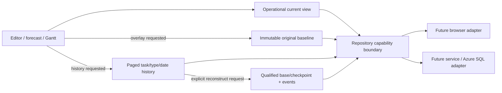

# Proposed memory and repository contracts

**Design notation only; no interface or adapter was added to production.**
Use storage-independent domain values. Repository resource IDs, cursors, read
sessions, transaction receipts, authentication and SQL row versions remain private
transport metadata; portable project/task identity is unchanged.



## Proposed API and compatibility classification

Introduce a separate capability, provisionally `OperationalHistoryRepository`.
Keep the accepted generic `ProjectRepository<S>` unchanged. Adding a new optional
capability is additive at the type level; replacing `load(): LoadedProject<S>`
with a partial object or calling a partial view S would be breaking. No existing
consumer is switched, and no compiled format model is implied by this notation.

```ts
// PROPOSAL ONLY: Result types include existing typed failures plus those below.
openRead(projectId, signal?): Promise<Result<ReadSession>>
loadOperational(readSession, signal?): Promise<Result<OperationalView>>
readOriginalBaseline(readSession, signal?): Promise<Result<BaselineValue>>
queryHistory(readSession, filter, page, signal?): Promise<Result<HistoryPage>>
readHistoricalRecord(readSession, recordId, signal?): Promise<Result<HistoricalRecord>>
listCheckpoints(readSession, page, signal?): Promise<Result<CheckpointPage>>
reconstructRecordedState(readSession, targetRevision, signal?): Promise<Result<Reconstruction>>
commitChange(request: AtomicChangeRequest, signal?): Promise<WriteResult>
exportPortable(readSession, sink, signal?): Promise<Result<ExportReceipt>>
releaseRead(readSession): Promise<void>
```

`ReadSession` pins namespace + stored project ID + exact revision/fingerprint,
event/sequence high-water mark and baseline identity. It has a bounded lifetime;
expiration returns `ReadExpired`, never silently switches to latest. The adapter
must support pinned reads (or explicitly report Unsupported). OpenRead captures
operational state at that head and keeps immutable history through its watermark.
It does not promise historical current snapshots for arbitrary old revisions.

`OperationalView` contains current project, retained task identities/current
inputs/lifecycle kind and last decision IDs, active graph/order, high-water IDs,
progress/criteria, qualified current actual facts and completion references,
remaining effort, capacity assumptions, accepted W plus its own context, and
honest history coverage. It contains no unbounded old decisions/events/checkpoints.
Optional recorded-work totals require completeness qualification and atomic
maintenance against work-entry corrections; until designed, retaining current
logs is the conservative option used in the measurement. Baseline load returns
Absent or the entire first immutable value/interpretation, preserving opaque JSON.

`filter` specifies any-of task ID(s), any-of event kinds and date basis (`recordedAt` or
`effectiveDate`), inclusive from/exclusive until and an explicit include-undated
choice. Null dates are not invented. Task references may include retired IDs.
`page` has a validated item limit (proposed 1–100) and max response bytes. The opaque
cursor binds all filters, project/namespace, pinned watermark and final stable
sequence/ID, so equal timestamps, new commits and joined task rows cannot create
duplicates or skips. Wrong filters/session/cursor reject `InvalidCursor`.
An individually oversized review returns metadata plus a separately bounded record
stream/explicit `RecordTooLarge`; never silently truncate a rationale or closure.

Reconstruction is **recorded revision**, not “truth as of effective date.” Results
are KnownRecordedState (with exact covered base/rule versions/provenance), Partial
(named missing ranges/fields) or Unknown/Unsupported. Do not give a complete-state
label to a partial replay. Checkpoints must bind the original baseline identity,
lineage, source revision, covered event bounds, interpretation and own bytes.
Corrupt source cannot be silently normalized; imported contradictions reject and
preserve raw data. Repository-private invalid derived caches can be quarantined
and recomputed only from otherwise validated complete coverage.

`AtomicChangeRequest` includes project ID, expected full RevisionRef, transaction
ID, next logical revision, complete candidate operational view, append-only typed
immutable records, review/closure context and explicit original-baseline guard.
The append set includes all domain events for the one revision; history is not
independently committed after current state. Missing definitions or incomplete
successor closure reject. The service validates against accepted source graph,
all affected tasks and prior immutable records; a UI `reviewed` flag is insufficient.
Creation/import remains a separately validated full-candidate operation; no new
create shortcut is introduced here.

Reusing current `WriteResult` semantics is additive only after the capability is
specified/tested. Exact request retry returns original receipt plus possibly newer
currentRef. Any changed intent using the same transaction ID rejects. Stale refs
must re-read and reconfirm affected decisions; no silent last-write-wins or blind
rebase of dates/retirement choices. Revisions and sequences remain distinct safe
integers. Cancellation before dispatch is NotCommitted; after uncertain dispatch
it cannot prove rollback. OutcomeUnknown is reconciled by unchanged-request retry,
not a new transaction or a guessed failure. Receipts are never portable events.

## Atomicity, failures and physical implementations

Proposed common boundary: validate detached input, verify immutable baseline and
history prefixes/definitions, compare expected ref, then atomically write current,
new records/index rows, head revision/digest/high-water counters and idempotency
receipt. Publish only on transaction commit. Failure before commit leaves all old
accepted data/ref unchanged. Lost acknowledgement after commit is OutcomeUnknown.
Orphan staging records are not queryable through committed heads and may be cleaned
only after proving they are unreferenced; never erase accepted audit data.

**Browser:** today's localStorage whole-library path cannot satisfy lazy fetching
or this multi-record contract. A future IndexedDB design could put heads/current,
baseline, immutable records/task indexes, checkpoints and receipts in stores with
one encompassing readwrite transaction per accepted change. Read/check/write must
stay in that transaction; no external await may accidentally let it become inactive.
Transaction abort, quota, tab termination, eviction and durability must be qualified
on supported browsers. Notifications may invalidate caches but never arbitrate
acceptance. A transaction's completion is not a blanket power-loss guarantee.
These are proposals; the [IndexedDB transaction specification](https://w3c.github.io/IndexedDB/#transaction-concept)
defines the underlying transaction lifecycle, atomicity and durability choices.

**SQL/service:** candidate mapping is Head(ProjectResource, Revision, Digest,
BaselineId, NextSequence), Current/CurrentTask/CurrentFact/WorkingContext,
OriginalBaseline, ImmutableEvent/TaskEventIndex, LifecycleDecision, Review/
ReviewOutcome, ArchivedEdgeEpisode, Checkpoint and Receipt. This is not DDL.
Use unique project-scoped immutable IDs and event sequences, foreign-key/definition
guards and useful task/type/recording-date indexes. A SQL transaction conditionally
updates the head where revision and digest match, inserts all associated rows and
receipt, then commits. Receipt lookup for an exact prior intent precedes stale-head
rejection. Concurrent loser rolls back its whole group and gets Conflict.

Azure SQL's rowversion may be an internal adapter token; it is not portable logical
revision, event sequence, actual date or digest. [Microsoft's rowversion documentation](https://learn.microsoft.com/en-us/sql/t-sql/data-types/rowversion-transact-sql?view=sql-server-ver17)
describes a database counter rather than clock time. Pinned multi-query exports need
a deliberately chosen read transaction/materialized manifest; statement snapshots
alone are insufficient for a whole export. Isolation, deadlocks and transient
failure retries require adapter tests; Azure SQL still has write blocking despite
row-versioned reads. [Microsoft concurrency guidance](https://learn.microsoft.com/en-us/azure/azure-sql/database/understand-resolve-blocking?view=azuresql).
No database/service or concurrency test was executed in this package.

## Full portable export/import and integrity

Lazy operational reads are not partial portable exports. Export pins one session,
reads the full original baseline and every retained definition/event/episode/review
in stable order through its watermark, resolves all references, materializes the
exact existing `/2` value and computes the existing full-snapshot digest:

```text
lowercaseHex(SHA256(UTF8("bugsys-gantt/snapshot-history/2\n") || JCS(file.snapshot)))
```

Export metadata and integrity stay outside D. Retired data, full baseline opaque
values, history/provenance, before-context and arrays remain covered. Physical
record hashes, checkpoint digests and an operational-view hash are not substitutes
for D. Canonical property ordering and unchanged array order follow
[RFC 8785](https://www.rfc-editor.org/rfc/rfc8785.html). The harness expands B/C back
to A to demonstrate exact current snapshot/digest equality on synthetic inputs;
it is not production codec or signature/provenance certification.

This creates an explicit cost gate: computing D over an ever-growing snapshot may
read all retained history on each commit/export, even if the client loads little.
Hashing separate records and hashing their hashes is NOT the current algorithm.
A backend could spool canonical ordered records and stream exact JCS bytes, but
must prove lexical/array/key ordering and arbitrary opaque object handling. General
JSON object property sorting can require buffering or external sorting. No constant
memory parser/exporter or incrementally composable hash was built/measured here.

Import first retains raw source and checks configured byte/depth/lexical limits,
including duplicates/invalid Unicode, before ordinary parse can lose evidence.
Validate full structure, digest and all domain/reference/closure/known-lineage
guards into detached/staged storage. Only a validated entire candidate may publish
atomically. Peak transient space includes raw bytes, decoded text, parsed/indexed
objects, canonical buffers and candidate/accepted state; it can greatly exceed
file size. A worker improves responsiveness but does not eliminate memory cost.
Streaming staging still needs full validation before acceptance and cannot expose
partial history. A higher-cap route must be explicitly qualified; failure/cancel
preserves accepted state/ref/baseline and source for recovery.

Exporting the factored B/C illustrations directly, or adding authoritative delta/
checkpoint fields to `/2`, changes the wire contract/digest input and needs owner
approved version/profile and migration decisions. Operational SQL/IndexedDB layout
can differ from portable JSON without such a wire amendment.
