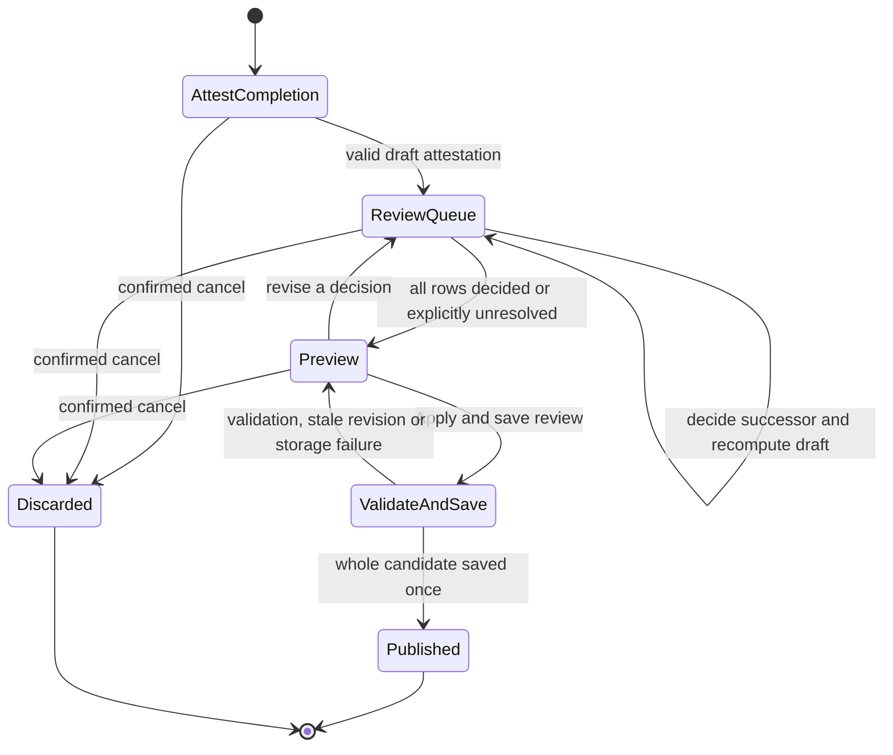

# Proposed guided review workflow and default Gantt

**Not implemented.** Policies P01-P12 and storage contract require separate
owner decisions. Established E01-E07 remain constraints. The current UI still
uses the WP7.3.3 chart and existing completion/Save workflow.

## One operation, from intent to confirmed saved document



1. **Start.** Existing completion control opens one review surface after all
   conflicting task/settings/effort/checklist drafts are finished or cancelled.
   Snapshot accepted document, project ID, document revision/fingerprint,
   original baseline digest, triggering element and local review date. A
   hypothetical PA As-of never authorizes historical commitment edits.
2. **Attest.** Keep current criteria, no-criteria acknowledgement, completion
   date and optional evidence rules. Stage the new status event and its
   pre-review commitment reference; do not call today's accepted `applyStatus`.
3. **Classify.** Compare actual effective date with the saved pre-review working
   finish date. Late/early use calendar dates; missing reference stays Unknown.
   On-date commonly has no needed decision, but a date-only release may rule
   out a same-day future start. Inspect readiness even when not historically late.
4. **Review.** Walk affected successors in deterministic topological order.
   Each choice changes only the candidate. Show unknown/conflicting evidence
   and allow explicit unresolved disposition with reason. Do not ask students
   to falsify an actual date to get through the wizard.
5. **Preview.** Show one consolidated before/after diff and all unresolved
   items. Require confirmation of every graph and future commitment change,
   even where a late chain propagates automatically in the candidate calculation.
6. **Validate/save/publish.** Obtain name/upgrade/overwrite decisions before
   applying. Recheck source under writer lock, baseline identity, whole graph,
   constraints, dates/statuses/history and format. Write one complete v2 record
   (per proposed contract); only then publish one accepted document and notice.
   Focus returns to the completion control or a stable task heading if deleted.
7. **Cancel/recovery.** Any pre-commit Cancel discards completion and all
   decisions. Dirty Escape/Close asks Keep reviewing or Discard entire review;
   backdrop click never applies. Failure returns to preview with draft intact.
   Reload before save loses only the draft after the existing unload warning;
   a saved transaction can be recovered by ID without duplicate events.

Source change during review invalidates the preview. Block concurrent local
editing; load/import/delete/duplicate actions require cancelling the review.
Changes from another v2 writer, imported replacement or calendar change force
rebuild from a new snapshot, never replay decisions silently onto new task IDs.
Do not hold a writer lock while the user thinks; acquire it for final validation
and write only. There is no durable autosave of wizard cursor/draft in this proposal.

## Atomic completion versus separately finalized review

| Alternative | Cancel meaning / benefit | Cost and recommendation |
| --- | --- | --- |
| One atomic completion + review (recommended P08) | No accepted completion, graph, actual-start or schedule edits until final Apply-and-save; easy undo of entire intent. | Longer completion route; explicit unresolved outcomes prevent forcing unsupported answers. A failed save leaves accepted document unchanged. |
| Save completion first, finish review later | Completion remains a valid fact if user leaves review; cancel discards only later edits. | Must persist pending review ID/state and expose outstanding work on reopen; cannot promise cancellation undoes completion. Separate owner policy/contract, not an invisible fallback. |

An on-time/no-impact completion can use a compact final summary and the same
atomic write path without unnecessary successor pages. A leaf completion has
no queue. Unknown historical comparison offers voluntary readiness review;
it never invents a late/early label. Future-effective completion relative to
the review date is not observed readiness: preserve existing warned intent
under a separately confirmed scenario/unresolved outcome, with no certified
early/late successor reschedule from that future fact. Do not weaken current
completion acknowledgements or rewrite imported future evidence.

## Deterministic queue and recomputation

Proposed algorithm, not a scheduler implementation:

1. Validate current/candidate graphs, build durable-ID adjacency and get the
   canonical topological order using code-point IDs. Index facts once per draft.
2. Seed directly affected successors of the triggering task from the **before**
   graph. Keep this review set even if a candidate edge is severed. Record all
   affected incoming causes; one queue entry per task ID, not per edge/path.
3. Walk dirty affected tasks in canonical topological order. A join is reviewed
   only after all its affected upstream decisions settle; inspect every retained
   incoming edge, including unaffected predecessors outside the dirty subgraph.
   Retain tied maximum releases and Unknown causes; do not pick one winner by ID.
4. Late keep proposals propagate later starts/finishes through all reachable
   ordinary Not Started descendants. Recompute each in topological order from
   its own floor and all retained bounds, rather than adding the parent's delay
   repeatedly. A join reached by two branches is evaluated once per draft version.
5. An approved early advance enqueues its direct successors for a **new offer**;
   their default remains keep. Earlier availability alone never lowers a floor.
   An explicit later availability date can dominate the apparent early opportunity.
6. Back-navigation upstream edits invalidates/recomputes dependent decisions
   and preview. Mark them Needs recheck, retaining entered reasons as draft
   suggestions; require reconfirmation where bounds/graph changed. Do not treat
   an old accepted-looking answer as valid under new predecessors.
7. Validate all active retained edges/cycles again before commit, even though
   removals alone cannot create cycles. IDs deleted/duplicated since snapshot
   invalidate review; copies do not inherit decisions. No task renaming or
   display sort affects queue identity/order.

Start bound for ordinary future work conceptually uses all planned not-before,
project/root availability, review-date and predecessor bounds. Completed actual
date A releases at first working slot **strictly after A**, never A's fabricated
finish hour. A known planned finish releases by its exact next slot; an unknown
started/blocked/reopened finish stays Unknown. A previously recorded start or
completion is never moved to satisfy the candidate graph.

Apply the review-date proposal floor only to the affected closure. Retain
unrelated accepted commitments/reference snapshots; expose an old unsupported
promise as needing review rather than changing it because today advanced.
Every changed boundary, including an indirect propagation, belongs in the
confirmed diff. Other task/calendar edit routes must participate in this
revision boundary before a future implementation can claim consistent working
commitments across the app.

Complexity: index facts O(H), adjacency/dirty traversal O(V+E), one calendar
evaluation per affected task per decision plus validation. Existing sorted-ready
graph utility has conservative O(V^2 log V + E), not linear. D user decisions
can require D recalculations; do not claim the entire interaction is O(V+E).
Cache by candidate revision, recompute the dirty closure in a later optimization,
and avoid enumerating paths, recursive UI renders or copied ancestor chains.
Benchmark 30/40 tasks, dense joins and long chains after implementation; keep
bounded row/list rendering. No new performance claim is established here.

## Per-successor screen and consolidated preview

```text
Review 2 of 6 - T2 Build model       Review date: Nov 6
Before working start: Nov 3 H1      Baseline: Nov 3 H1 (read-only)
Actual Start: Unknown               Earliest release: Mon Nov 9 H1
Why: T1 completed Fri Nov 6, time unknown; all other predecessors shown below

Did T2 wait for T1?
( ) Keep dependency - propose Nov 9 or later
( ) Remove T1 -> T2 - reason required; actual start or current/future plan
( ) Evidence unresolved - reason required; no certified future finish

Other required predecessors / tied bounds / availability / date warnings
Back   Next                         Cancel entire review
```

No radio asserting historical facts or severing an edge is preselected. Early
review does default **Keep current committed start**, with an alternative
**Start at earliest feasible working day** disabled/explained when a required
bound is Unknown. Historical feasibility triggers Yes/No/Unknown start inquiry.
Date entry always labels Planned versus Actual, shows normalization and units,
and offers a later date when student availability prevents an early start.

The final preview lists changed task IDs/names, retained/removed edges and
reasons, before working start/finish, original baseline reference, attested
actual date or revised planned slot, all releases, affected descendants and
project finish before/after. Mark date-only, Unknown and conservative values
explicitly. Include unchanged branches/absorbed impact in the summary and all
affected rows in reachable details. Never sum branch delays into project delay.
Show effort values as unchanged inputs, with FF recalculation separately named.
Warn that committed CPM is the legacy-plan analysis until a new one is approved.

## Already-started and conflicting successors

| Successor evidence | Review treatment |
| --- | --- |
| In Progress without start | Ask for optional historical attestation or keep Unknown. Keep status; no full-duration restart or inferred finish. |
| Blocked | Preserve reason; Actual Start can be known, restart and finish still Unknown. No automatic unblocking. |
| Complete | Keep completion/criteria/history; optional valid start backfill only. Graph decision may explain bypass; it does not rewrite when work happened. |
| Reopened | Prior first start/completions remain history; no old completion release or new restart inferred. Existing remaining-effort reassessment stays mandatory for an explicit reopening command. |
| Actual start before retained predecessor completion | Definite bypass conflict. Explicit sever with reason or retained unresolved conflict; do not shift the actual date. |
| Same-date actual start/completion order | Intraday order unverified. Do not fabricate a timestamp or force a false historical correction. |

## Proposed minimal default Gantt

This is a design alternative to today's [WP7.3.3 multi-lane chart](../wp7-3-3/README.md),
not a delivered UI. Evaluate it with the owner before replacing that default.

| Task evidence | One primary representation proposed |
| --- | --- |
| Ordinary Not Started, confirmed working commitment | One labelled planned start-finish span. Persistent Feasibility needs review / PA Unknown badge if the accepted promise is not presently supported. Never silently substitute PA for a confirmed commitment. |
| In Progress with Actual Start | Actual start date marker/open end; finish Unknown unless independently supported. If a planned reference is requested, show it as an optional comparison, never an actual duration. |
| In Progress without Actual Start / Blocked / reopened | Status plus Start Unknown or historical first-start marker and finish Unknown. No bar invented from elapsed plan dates or remaining person-hours. |
| Complete with both actual dates | Thin bracket/outline over the actual calendar lifespan, labelled Actual dates; elapsed interval is not continuous work. Actual finish and late/early/on-date badge remain explicit. |
| Complete with only actual completion | One Actual finish date marker and Start Unknown; do not reuse the planned start to fill an actual span. |

Late/early badge always states the saved historical commitment comparison and
calendar-day variance when known, even for leaf/absorbed cases. Missing snapshot
is unavailable. Proposed default hides the thick red extension and simultaneous
C/R/PA lanes; Comparison/details can reveal exact current, historical, release,
PA and FF evidence without changing it. A baseline command remains visible and
the original View Baseline works independently of details. Completed evidence
is never made less truthful merely to obtain one filled bar.

Default retained dependency lines describe accepted relationships. Actual-source
handoffs carry a release-bound description, not an exact finish-hour claim;
Unknown/conflicted edges use an uncertainty label instead of a precise shifted
arrow. Optional expanded comparison can show R and the conservative bound.
Compressed nonworking actual dates keep exact labels and collapsed-date glyphs.
Scales, keyboard selection, Go to selected/impact, bounded rendering and
nonworking hatching retain their meanings. Baseline, historical comparison,
working commitment and FF have named references; a planned critical outline
is not copied onto an actual/conditional span.

## Accessibility and interruption contract

Use one labelled modal or full-height responsive review panel, not one popup
per successor. Trap modal focus and mark background inert only while modal;
show step count and task ID in the heading. On Next/Back focus the new heading;
on error focus a linked error summary and keep values. Tab reaches every row,
date, reason, detail and action; Space/Enter selects controls without accidental
submission. Announce concise recompute results politely, not every graph node.

At600px use stacked fields, independently scrollable body with visible actions
and no horizontal page overflow. Forty-task review uses a navigable step list
and paged/virtualized preview with full accessible details; no mandatory 40
simultaneous popups. Escape/Close preserves draft until an explicit discard
choice; cancelling restores trigger focus. Test screen-reader labels for
actual versus planned dates, disabled-advance explanation, reasons and Unknown.
Keyboard automation cannot establish student comprehension; require owner
walkthrough, and a facilitated student review if comprehension must be measured.
